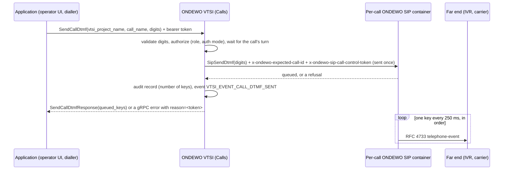

# DTMF keys in the ONDEWO VTSI API

This guide describes the DTMF (keypad) features of the ONDEWO VTSI API. The generated reference of every message and
field is [index.md](index.md) (also `index.html`); this page explains how the pieces fit together. It covers ONDEWO
VTSI API **9.4.0**, built on ONDEWO SIP API 5.6.0 and ONDEWO CSI API 5.8.0.

DTMF travels in two directions on a VTSI call:

| Direction | What happens | API |
| --- | --- | --- |
| **Sending** | an application presses keys from the bot's leg towards the far end, e.g. to navigate the IVR an outbound call reached, or to enter a code on the caller's behalf | `Calls.SendCallDtmf`, event `VTSI_EVENT_CALL_DTMF_SENT` |
| **Receiving** | the caller presses keys; the bot turns them into caller turns when its last answer declared a key menu or a key entry | `VoiceInteractionConfig.dtmf_config` (`DtmfConfig`) configures it per call |

## Sending keys: `Calls.SendCallDtmf`

```protobuf
rpc SendCallDtmf (SendCallDtmfRequest) returns (SendCallDtmfResponse);

message SendCallDtmfRequest {
    string vtsi_project_name = 1;   // projects/<project_uuid>/project
    string call_name = 2;           // the connected call
    string digits = 3;              // 1 to 64 of 0-9 * # A-D; never logged (it may be a PIN)
}

message SendCallDtmfResponse {
    string vtsi_project_name = 1;
    string call_name = 2;
    int32 queued_keys = 3;          // the number of keys queued: the length of digits
}
```

### Sequence



### Semantics

- **Keys.** `digits` is 1 to 64 characters, each one of `0`-`9`, `*`, `#`, `A`-`D`. It is validated before
  anything else is read; an invalid value refuses the whole request and nothing is sent.
- **Queued, not delivered.** The response means the per-call container queued the keys. They go out as RFC 4733
  telephone events from the bot's leg, **one every 250 ms**, in order (64 keys take about 16 s). If the call ends
  meanwhile, the remaining keys are dropped. A peer that did not negotiate `telephone-event` receives no key, and
  this is not reported.
- **Ordering.** A later request for the same call follows the earlier one and never interleaves with it.
- **Inaudible to the bot.** No tone is played into the call audio, so the bot's speech recognition and a listener
  on `StreamCallAudio` / `ListenCallAudio` do not hear the keys.
- **Sent once.** VTSI sends the request to the container exactly once and never retries it: a re-sent key is a
  second key press. Do not retry `SendCallDtmf` blindly when its outcome is unknown either.
- **Response.** `queued_keys` is the number of keys queued, i.e. the length of `digits`. `vtsi_project_name` and
  `call_name` echo the request.

### Authorization and auditing

- Requires the role **`PROJECT_DEVELOPER`** or higher on the project, and the server's Keycloak auth mode
  **`ENFORCE`**. Otherwise `PERMISSION_DENIED`, or `FAILED_PRECONDITION` with `reason=call-supervision-requires-auth`
  when inbound authentication is not enforced.
- Every request writes one call-supervision audit record (who, which call, when, the outcome and the NUMBER of
  keys), whatever the outcome. No announcement is played to the caller.
- VTSI authenticates itself to the per-call container with a per-container call-control token and scopes the request
  to the call with the call's `sip_call_id`; applications never see either.

### Event `VTSI_EVENT_CALL_DTMF_SENT = 123`

Emitted once the keys are queued (not for a refused request). It sets `call_name` and carries two attributes:

| Attribute | Value |
| --- | --- |
| `keys` | the NUMBER of keys queued, never the keys |
| `actor` | the authenticated user who sent the request, when known |

### Errors

Errors are gRPC status codes whose details carry a stable `reason=<token>`; match the token, never the free text.

| Status | `reason` | Meaning | What to do |
| --- | --- | --- | --- |
| `INVALID_ARGUMENT` | `invalid-digits` | `digits` is empty, longer than 64, or contains a character outside `0-9 * # A-D` | Fix the request |
| `NOT_FOUND` | `call-not-found` | The call does not exist in this project | Check `call_name` and `vtsi_project_name` |
| `FAILED_PRECONDITION` | `call-not-connected` | The call is not (or no longer) connected | Act only on a connected call |
| `FAILED_PRECONDITION` | `amd-in-progress` | Answering machine detection is deciding, hanging up or leaving a voice message | Retry after the verdict |
| `FAILED_PRECONDITION` | `call-not-yet-identified` | VTSI has not yet learned the call's `sip_call_id` | Retry after a second |
| `FAILED_PRECONDITION` | `sip-image-too-old` | The call's SIP image predates ONDEWO SIP API 5.6.0 | Deploy a newer SIP image |
| `FAILED_PRECONDITION` | `no-audio-stream` | The call is connected but its audio stream is not established | Retry |
| `FAILED_PRECONDITION` | `call-supervision-requires-auth` | The server does not enforce inbound authentication | Enable Keycloak auth mode `ENFORCE` |
| `ABORTED` | `call-control-busy` | Another call-control request for the call is still running | Retry |
| `UNAVAILABLE` | `sip-unreachable` | The per-call container could not be reached | Retry; the keys were not queued |
| `PERMISSION_DENIED` | | The caller lacks the required project role | Use an account with `PROJECT_DEVELOPER` or higher |

The call-control tokens shared with the other call-control RPCs can also appear, e.g. `call-control-not-configured`
(the container was deployed without a call-control key) or `call-scope-mismatch` (the call moved on while the request
was prepared).

## Receiving keys: `DtmfConfig`

A key the caller presses reaches the bot only when the bot's last NLU answer declared a key menu or a key entry
(ONDEWO NLU intent tags `ondewo-voice:dtmf-menu:<id>` / `ondewo-voice:dtmf-digits:<id>`, or the `c-voice-turn`
context of an AI Team). The keys are then sent to the NLU as the turn text `[DTMF:<keys>]` (`*` and `#` spelled `STAR`
and `HASH`) with the one-turn context `c-dtmf`. The full model (menus, key entries, terminators, timeouts, invalid
entries) is in the [ONDEWO CSI API DTMF guide](https://github.com/ondewo/ondewo-csi-api/blob/master/docs/dtmf.md).

```protobuf
message VoiceInteractionConfig {
    // ...
    DtmfConfig dtmf_config = 5;
}

message DtmfConfig {
    optional bool enabled = 1;
    optional bool barge_in = 2;
    optional uint32 inter_digit_timeout_ms = 3;
    optional string undeclared_policy = 4;
}
```

`VoiceInteractionConfig` is part of `CommonServicesConfig.voice_interaction_config`, so the configuration is given
per caller, listener or call wherever a `CommonServicesConfig` is accepted.

### Fields

Every field is `optional`. An unset field keeps the replica-wide setting of the VTSI server
(`ONDEWO_VTSI_CSI_DTMF_*` / `ONDEWO_VTSI_SIP_DTMF_FORWARD_ACTIVE`), else the default. A set field wins over its
replica setting in either direction.

| Field | Default | Validation | Meaning |
| --- | --- | --- | --- |
| `enabled` | `true` | | Whether a pressed key is forwarded to the bot at all. `false` ignores every key of the call (the SIP container does not forward keys and the bot takes none). |
| `barge_in` | `true` | | Whether a key pressed while the bot speaks stops the bot at once, like a confirmed spoken interruption; it applies also when spoken interruptions are switched off. `false` lets the bot finish. |
| `inter_digit_timeout_ms` | `2000` | 300 - 10000 | Milliseconds after the last key of a key entry without a terminator (e.g. a PIN) before the entry is sent. A key entry declared with its own timeout uses that one. |
| `undeclared_policy` | `DROP` | exactly `DROP` or `COMMIT_SINGLE` | What a key the bot declared nothing for does: `DROP` ignores it and does not interrupt the bot; `COMMIT_SINGLE` sends it to the NLU as a one-key turn. |

A value outside its range is refused with `INVALID_ARGUMENT` naming the field.

| Field | Replica setting (VTSI server) | Delivered to the call as |
| --- | --- | --- |
| `enabled` | `ONDEWO_VTSI_CSI_DTMF_ACTIVE`, `ONDEWO_VTSI_SIP_DTMF_FORWARD_ACTIVE` | `CSI_DTMF_ACTIVE` and `SIP_DTMF_FORWARD_ACTIVE` |
| `barge_in` | `ONDEWO_VTSI_CSI_DTMF_BARGE_IN_ACTIVE` | `CSI_DTMF_BARGE_IN_ACTIVE` |
| `inter_digit_timeout_ms` | `ONDEWO_VTSI_CSI_DTMF_INTER_DIGIT_TIMEOUT_MS` | `CSI_DTMF_INTER_DIGIT_TIMEOUT_MS` |
| `undeclared_policy` | `ONDEWO_VTSI_CSI_DTMF_UNDECLARED_POLICY` | `CSI_DTMF_UNDECLARED_POLICY` (`drop` / `commit_single`) |

## Security

- **The keys are a credential.** They may be a PIN or a customer number entered on the caller's behalf. VTSI never
  writes them to a log line, an event, an audit record, a trace span or an error detail; only their number appears
  (`keys` attribute of the event, the audit record, `<dtmf:N>` in logs). The SIP and CSI containers follow the same
  rule for keys the caller presses.
- **Treat `digits` like a password in your own code**: do not log the request, and do not put real PINs in tests.
- **Authentication and authorization** as described above; the per-container call-control token between VTSI and the
  SIP container is never exposed to applications.

## Examples

The Python client is [ondewo-vtsi-client-python](https://github.com/ondewo/ondewo-vtsi-client-python) 9.4.0 or
later. The values below are fictional.

Press `1` and then `#` on a connected call through the published method `Calls.send_call_dtmf`:

```python
import grpc

from ondewo.vtsi.calls_pb2 import SendCallDtmfRequest, SendCallDtmfResponse
from ondewo.vtsi.client.client import Client
from ondewo.vtsi.client.client_config import ClientConfig

config: ClientConfig = ClientConfig(host="vtsi.example.invalid", port="443")  # TLS and Keycloak settings omitted
client: Client = Client(config=config, use_secure_channel=True)

request: SendCallDtmfRequest = SendCallDtmfRequest(
    vtsi_project_name="projects/00000000-0000-0000-0000-000000000000/project",
    call_name="projects/00000000-0000-0000-0000-000000000000/callers/11111111-1111-1111-1111-111111111111"
    "/calls/22222222-2222-2222-2222-222222222222",
    digits="1#",
)
try:
    response: SendCallDtmfResponse = client.services.calls.send_call_dtmf(request)
    print(f"queued {response.queued_keys} keys")
except grpc.RpcError as error:
    print(f"refused: {error.code().name} {error.details()}")  # e.g. FAILED_PRECONDITION reason=call-not-connected
```

The async service offers the same method (`await client.services.calls.send_call_dtmf(request)`).

Configure the caller's keys for the calls of a listener or caller (`CommonServicesConfig`):

```python
from ondewo.vtsi.call_configs_pb2 import CommonServicesConfig, DtmfConfig, VoiceInteractionConfig

common_services_config: CommonServicesConfig = CommonServicesConfig(
    # ... s2t, nlu, t2s and csi configuration ...
    voice_interaction_config=VoiceInteractionConfig(
        dtmf_config=DtmfConfig(
            barge_in=True,
            inter_digit_timeout_ms=3000,  # a slower PIN entry
            undeclared_policy="DROP",
        ),
    ),
)
```

Fields left unset (here `enabled`) keep the server's setting.

## Limits

| Limit | Value |
| --- | --- |
| Keys per `SendCallDtmf` | 1 to 64 |
| Key alphabet | `0`-`9`, `*`, `#`, `A`-`D` |
| Interval between two sent keys | 250 ms (64 keys take about 16 s) |
| Keys a caller can enter in one key entry | up to 32 (ONDEWO CSI clamps a declared maximum to 32); entries of 1 to 30 keys are tested end to end on live calls |
| `DtmfConfig.inter_digit_timeout_ms` | 300 - 10000 ms, default 2000 |

## See also

- [ONDEWO SIP API: DTMF](https://github.com/ondewo/ondewo-sip-api/blob/master/docs/dtmf.md): `SipSendDtmf`, the RPC
  behind `SendCallDtmf`, and how the SIP endpoint admits and forwards a caller's keys.
- [ONDEWO CSI API: DTMF](https://github.com/ondewo/ondewo-csi-api/blob/master/docs/dtmf.md): how keys become caller
  turns (`SetCallerDtmf`, key menus and key entries, `[DTMF:<keys>]`, `c-dtmf`).
- Server documentation (ONDEWO VTSI): `docs/docs/api/calls.md` § SendCallDtmf, `docs/docs/api/events.md`,
  `docs/docs/api/error-handling.md`, `docs/docs/user-guide/voice-interaction.md` § DtmfConfig and
  `docs/docs/deployment/environment-variables.md` (the `ONDEWO_VTSI_CSI_DTMF_*` settings).
- [RFC 4733](https://www.rfc-editor.org/rfc/rfc4733): RTP payload for DTMF digits, telephony tones and signals.
