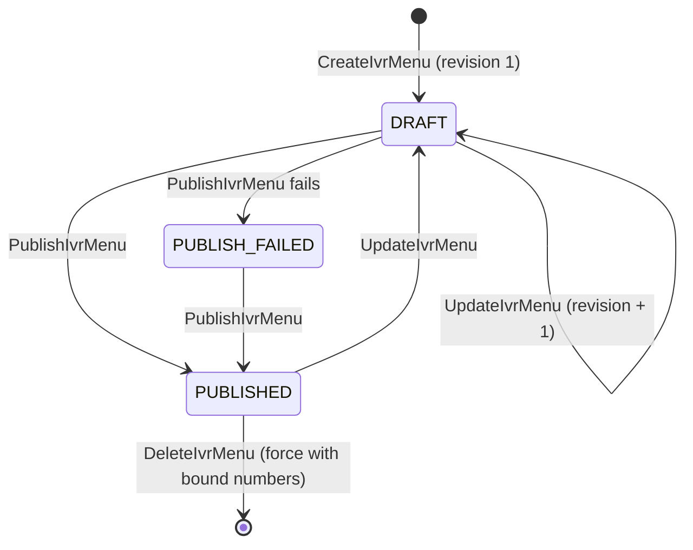

# IVR menus in the ONDEWO VTSI API

This guide describes the IVR menus of the ONDEWO VTSI API (`ondewo/vtsi/ivr_menus.proto`, service `IvrMenus`). The
generated reference of every message and field is [index.md](index.md) (also `index.html`); this page explains how
the pieces fit together. It covers ONDEWO VTSI API **9.5.0**.

An IVR menu is the keypad menu a caller dialling one of the project's inbound phone numbers goes through BEFORE a bot
or a person takes the call: "press 1 for sales, 2 for billing". The project's Asterisk runs it as generated
dialplan, so a menu keeps working while VTSI is down, and no user text (a label, a prompt text, a display name) ever
reaches the dialplan: contexts are named by ids, prompts by their SHA-256, keys are validated single characters.

## The graph

A menu (`IvrMenu`) is a graph of nodes (`IvrNode`) with one `entry_node_id`:

| `IvrNodeType` | Plays | Leads to |
| --- | --- | --- |
| `IVR_NODE_TYPE_MENU` | `prompt`, then waits `timeout_s` (default 5) for a key | the `options` key's `next_node_id`; after `max_retries` (default 2) invalid keys `invalid_next_node_id`, after as many timeouts `timeout_next_node_id` (empty: hang up); `reprompt` before each retry |
| `IVR_NODE_TYPE_PLAY` | `prompt` | `next_node_id` |
| `IVR_NODE_TYPE_SCHEDULE` | nothing | `next_node_id` inside `schedule` (a `CampaignCallingWindow`: time zone + weekly slots), `closed_next_node_id` outside |
| `IVR_NODE_TYPE_ROUTE` | nothing | leaves the menu to `route_target`; when it does not answer, `busy_next_node_id` (empty: a busy announcement and hang up) |
| `IVR_NODE_TYPE_GOTO_MENU` | nothing | the entry node of the PUBLISHED revision of `goto_menu_name`, another menu of the project |
| `IVR_NODE_TYPE_HANGUP` | nothing | hangs up |

A ROUTE target is a `CallTarget`: `listener_queue` or `listener_name` (a bot takes the call), `softphone_account_name`
or `phone_number` (a person takes it; the number must pass `VtsiProject.transfer_phone_number_allowlist`).
`ivr_menu_name` is refused there: use a GOTO_MENU node.

Every node entry counts towards `ONDEWO_VTSI_IVR_MAX_HOPS` (50), across menus; the call is hung up after that, so a
"back to the main menu" key or a cycle of GOTO_MENU nodes can never loop for ever.

### Prompts

`IvrPrompt` has exactly one source:

- `text`: 1 to 1000 characters, synthesized by VTSI with text-to-speech at publish, in the menu's `language_code`
  with its `t2s_pipeline_id` (empty: the project's defaults), cached by content.
- `wav`: RIFF PCM 16 bit mono at 8000 or 16000 Hz (VTSI does not transcode), at most
  `ONDEWO_VTSI_IVR_MAX_PROMPT_BYTES` (1 MiB) and 120 seconds; at most `ONDEWO_VTSI_IVR_MAX_PROMPTS_TOTAL_BYTES`
  (50 MiB) per menu.
- `asterisk_sound`: a stock sound of the project's Asterisk image, one of `beep`, `all-circuits-busy-now`,
  `pls-hold-while-try` and `goodbye`. Publish checks that every prompt file exists in the Asterisk and fails otherwise.

`sha256` is filled at publish with the content id of the rendered audio.

## Lifecycle

- **Save.** Create and Update validate the menu and save a DRAFT revision. `layout` (canvas positions) is saved
  without a new revision. `UpdateIvrMenuRequest.expected_revision` guards against a concurrent edit
  (`ABORTED reason=revision-mismatch`).
- **Validate.** `ValidateIvrMenu` returns every issue at once, with its node path; Create and Update refuse with the
  first ERROR issue (`INVALID_ARGUMENT`).
- **Publish.** `PublishIvrMenu` re-validates (the allowlist, the softphones or the listeners may have changed), renders
  the prompts and the dialplan into the project's Asterisk, reloads and reads it back, checks every prompt file, and
  only then switches the menu's `inbound_phone_numbers` to the new revision. Any failure restores the previous
  dialplan and leaves the previous published revision live (`IVR_MENU_STATE_PUBLISH_FAILED`, `state_message`).
  Binding a number ends no call, and a caller inside a menu finishes on the revision they entered.
- **Route.** A published menu takes its `inbound_phone_numbers`, and the one menu with `default_inbound` takes every
  number no menu names. A `disabled` menu is unrouted on its next publish. `VtsiProject.ivr_menus_enabled=false`
  switches every route of the project off at once and keeps the bindings.
- **Delete.** A PUBLISHED menu with bound numbers needs `force` (`FAILED_PRECONDITION reason=menu-published`); a menu
  a GOTO_MENU node of another menu names cannot be deleted (`reason=menu-referenced`).
- **Clone.** `CloneIvrMenu` copies a revision into a new DRAFT menu without numbers.

## Testing: `TestIvrMenu` and `GetIvrMenuTest`

`TestIvrMenu` starts a test call through the PUBLISHED revision and returns at once with an `IvrMenuTest` in
`IVR_MENU_TEST_STATE_RUNNING`; poll `GetIvrMenuTest` with its `name` until the state is `SUCCEEDED`, `TIMED_OUT` or
`FAILED`. A finished test is kept 24 hours.

- The test call runs INSIDE the project's Asterisk: a local channel enters the menu and presses the scripted keys
  (`steps`: wait `wait_ms`, default 1000, then press `dtmf`; an empty `dtmf` takes the timeout path).
- No SIP container, no bot and no NLU session take part, and no call record is written.
- Every ROUTE node is a stub that records `route:<kind>:<target>` (`IvrMenuTest.route`) and hangs up: **a test never
  dials a listener, a softphone account or a phone number.**
- `path` lists every node entered, with the input that left it and `entered_at` to the millisecond.

## What a bot learns, and what a call records

A call that reaches a bot through a menu carries three headers into the bot's SIP context:

| Header | Value |
| --- | --- |
| `X-ondewo-ivr-menu` | the menu's display name, sanitized |
| `X-ondewo-ivr-path` | the option labels taken, e.g. `main:1>billing:2`, at most 256 characters |
| `X-ondewo-dialed-number` | the inbound number the caller dialled |

The call records the first two in `Call.ivr_menu_display_name = 27` and `Call.ivr_path = 28`, and the resource name
of the same menu (`projects/<project_uuid>/ivr_menus/<ivr_menu_uuid>`) in `Call.ivr_menu_name = 29`. A call routed
straight to a person leaves no call record; `IvrMenu.node_stats` (only with the `field_mask` path `node_stats`)
counts every node entry anyway, approximately, collected about once a minute.

`TransferCall(TRANSFER_MODE_BLIND)` with `CallTarget.ivr_menu_name` sends a connected call into the entry node of a
published menu.

## Validation issues

`IvrMenuIssue.code` is one of:

| Code | Severity | Meaning |
| --- | --- | --- |
| `missing-entry-node` | ERROR | `entry_node_id` names no node |
| `dangling-next-node` | ERROR | a `*_node_id` names no node |
| `duplicate-node-id` | ERROR | two nodes share a `node_id` |
| `invalid-node-id` | ERROR | a `node_id` is not `^[a-z0-9_-]{1,64}$` |
| `duplicate-key` | ERROR | two options of a MENU node share a key |
| `invalid-key` | ERROR | a key is not one of `0-9 * #` |
| `unreachable-node` | ERROR | a node cannot be reached from the entry node |
| `keyless-cycle` | ERROR | a cycle through PLAY, SCHEDULE or ROUTE-busy edges only (a cycle through a MENU key is allowed) |
| `field-not-for-node-type` | ERROR | a field set on a node type it does not apply to |
| `missing-field` | ERROR | a field the node type requires is unset |
| `value-out-of-range` | ERROR | a timeout, a retry count, a length or a count outside its range |
| `number-not-allowed` | ERROR | a ROUTE phone number is not E.164 or fails the allowlist |
| `unknown-softphone` | ERROR | a ROUTE softphone account does not exist in the project |
| `unknown-listener` | ERROR | a ROUTE listener does not exist in the project |
| `unknown-menu` | ERROR | a GOTO_MENU names no menu of the project |
| `self-goto` | ERROR | a GOTO_MENU names its own menu |
| `number-bound-twice` | ERROR | an inbound number is bound by another menu |
| `second-default-inbound` | ERROR | another menu already has `default_inbound` |
| `prompt-format` | ERROR | a WAV prompt is not PCM 16 bit mono at 8000 or 16000 Hz |
| `prompt-too-large` | ERROR | a prompt exceeds its size or duration limit |
| `unknown-asterisk-sound` | ERROR | an `asterisk_sound` is not on the allowlist |
| `too-many-nodes` | ERROR | more than `ONDEWO_VTSI_IVR_MAX_NODES` nodes |
| `menu-without-prompt` | WARNING | a MENU node has no prompt |

## Configuration

| Setting | Default | Meaning |
| --- | --- | --- |
| `ONDEWO_VTSI_IVR_ACTIVE` | `false` | `false`: every `IvrMenus` RPC answers `UNIMPLEMENTED reason=ivr-disabled`, and the next deploy removes the routes |
| `ONDEWO_VTSI_IVR_MAX_NODES` | 100 | nodes per menu |
| `ONDEWO_VTSI_IVR_MAX_MENUS_PER_PROJECT` | 50 | menus per project |
| `ONDEWO_VTSI_IVR_MAX_PROMPT_BYTES` | 1048576 | per uploaded prompt |
| `ONDEWO_VTSI_IVR_MAX_PROMPTS_TOTAL_BYTES` | 52428800 | per menu |
| `ONDEWO_VTSI_IVR_MAX_HOPS` | 50 | node entries per call, across menus |
| `ONDEWO_VTSI_IVR_TEST_MAX_DURATION_S` | 300 | ceiling of `TestIvrMenuRequest.max_duration_s` |
| `VtsiProject.ivr_menus_enabled` | `true` | the project's switch |

`VtsiProject.feature_availability.ivr` (`IvrAvailability`) says whether a project can use IVR menus:
`AVAILABLE`, `DISABLED_BY_DEPLOYMENT` or `NEEDS_LOCAL_ASTERISK` (a project whose Asterisk this server does not run).

## Authorization, events and privacy

- **Authorization** (Keycloak `ENFORCE`, as Campaigns): `PROJECT_DEVELOPER` for Create, Update, Delete, Publish, Clone
  and Test; `PROJECT_EXECUTOR` for Get, List, Validate, ListRevisions, GetDialplan and GetIvrMenuTest.
- **Events** (`resource_name`: the menu): `VTSI_EVENT_IVR_MENU_CREATED = 1001`, `_UPDATED = 1002`,
  `_DELETED = 1003`, `_PUBLISHED = 1004`, `_PUBLISH_FAILED = 1005`, `_TESTED = 1006`, with the attributes `revision`,
  `node_count` and `routed_numbers` (a COUNT, never a number).
- **Privacy.** v1 has no digit entry, so no customer data enters headers or logs; keys appear in logs only as
  `<dtmf:1>`. Labels and display names reach the bot's SIP context, so they must never carry a secret. The dialled
  number is the company's own and is logged masked to its last 3 digits.
